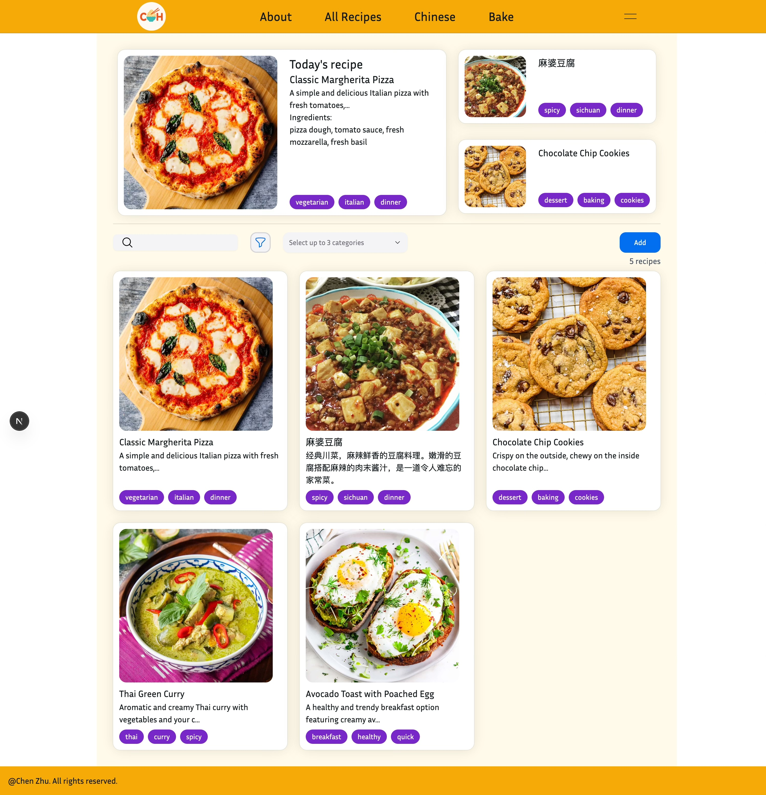

I designed and implemented this website, that shows my favorite collection of recipes. The goal of this website is to create a basic CRUD feature of recipes. Mostly get recipes and store recipes, it's ad free, concise, and just recipes no more stories. Therefore we can have a central source of truth place to find our favorite recipes, frustration-free!

## Features

- Show top section of today's recipe inspirations, it will rotate every day.
- Each recipe card will show recipe name, description, and up to 3 tags.
- Able to browse all recipes in the recipe display section.
- Search recipe will match recipe name, description, tags, cuisine, ingredients, and equipments.
- Open filters to further filter recipe you wanted.
- Add recipe button will lead to /add page. Which is yet to be implemented.
- Show total amount of recipes, based on all search and filter results.
- Responsive design that is tablet and mobile friendly.
- Preview: 

### Planned Future Milestones

- [x] Filter recipes.
- [x] Recipe details page.
- [x] Migrate recipes from local to real database.
- [x] Data migration of real recipes.
- [ ] [Make Supabase the single source of truth](docs/decisions.md#supabase-source-of-truth-and-recovery).
- [ ] [Back up Supabase data and verify recovery](docs/decisions.md#supabase-source-of-truth-and-recovery).
- [ ] [Add recipes through a standalone import script](docs/decisions.md#supabase-source-of-truth-and-recovery).
- [ ] User authentication.
- [ ] Wishlist

## Development Setup

After you cloned this code base. Run:

```bash
npm install

```

After all dependencies installed, you can start the localhost. Run:

```bash
npm run dev
```

Open [http://localhost:3000](http://localhost:3000) with your browser to see the result.

You can start editing the page by modifying `app/page.tsx`. The page auto-updates as you edit the file.

## Add new recipe

The seed script reads `SUPABASE_URL` and `SUPABASE_SECRET_KEY` from `.env.local`.

1. Add a recipe to [`src/data/exampleRecipes.ts`](src/data/exampleRecipes.ts) with a unique `slug`. Follow the existing recipe format for ingredients and steps.
2. Add its image under `public/exampleRecipes/` and set the recipe's `pictureUrl` to `/exampleRecipes/<filename>`.
3. Run the seed script with the new recipe's slug:

   ```bash
   npm run seed:supabase -- --slug margherita-pizza
   ```

This uploads only the selected recipe's image and inserts or updates that recipe in Supabase. Ingredients and steps are converted to JSONB automatically. An existing recipe with the same slug and its image will be overwritten.

To reseed all local recipes and images, run `npm run seed:supabase` without `--slug`.

## Deployment

This website is deployed to: TBD.
